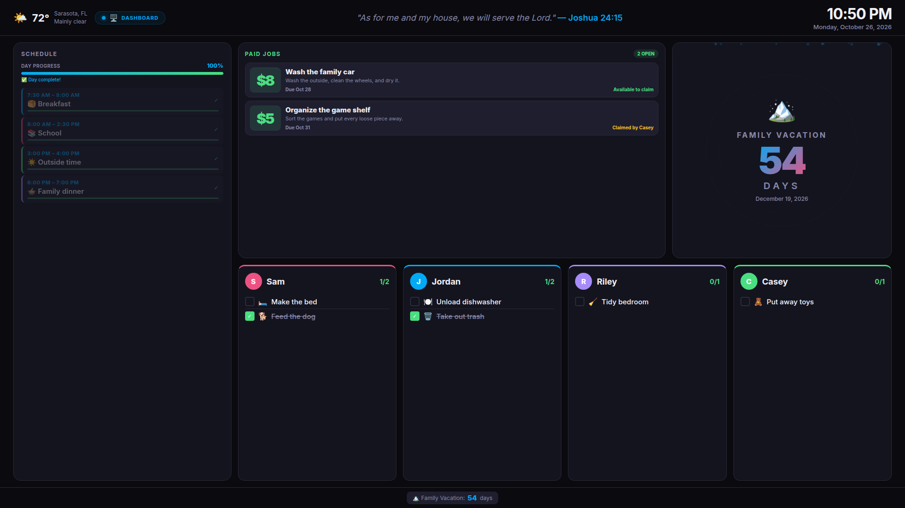

# 🏠 Graber Hub

An open-source family command center for a Raspberry Pi and wall-mounted display. It puts the day's schedule, chores, paid jobs, countdowns, Scripture, weather, and family photos in one place—and lets parents manage it from Android.



[](LICENSE)


[](https://github.com/JasonGraber/graber-hub-app)

## Why it exists

Family logistics usually live across chore apps, calendars, timers, sticky notes, and photo frames. Graber Hub combines those jobs into a calm, always-visible screen that the whole family can understand at a glance.

- **Kids see what is happening now and what they own next.**
- **Parents update the day from a phone instead of touching the wall display.**
- **Completed chores fall to the bottom; unfinished work stays visible.**
- **Everything is self-hosted.** Your family data stays on your Pi.
- **No subscription is required.** The project is MIT licensed.

## Features

| Feature | Wall display | Android app | Wear OS |
|---|---:|---:|---:|
| Daily schedule | ✅ | Manage | View |
| Chores and recurring chores | ✅ | Manage | Complete |
| Paid jobs | ✅ | Post, claim, complete | — |
| Countdown events | ✅ | Manage | View |
| Bible verse | ✅ | Manage | — |
| Uploaded/Google photos | ✅ | Manage | — |
| Weather | ✅ | — | — |
| Dashboard / Photos / Auto modes | ✅ | Switch | — |

## Components

- **This repository:** Raspberry Pi web dashboard, API, optional voice webhook, and Wear OS client.
- **[graber-hub-app](https://github.com/JasonGraber/graber-hub-app):** supported Android phone companion.

The old `android/` directory is retained as historical reference. New phone work belongs in the companion-app repository.

## Quick start

### Try it locally

Requires PHP 7.4+.

```bash
git clone https://github.com/JasonGraber/graber-hub.git
cd graber-hub
./scripts/dev-demo.sh
```

Open <http://127.0.0.1:8080/>. The demo uses temporary fictional data and does not touch your real files.

### Install on Raspberry Pi

```bash
git clone https://github.com/JasonGraber/graber-hub.git
cd graber-hub
GRABER_HUB_TIMEZONE=America/New_York ./scripts/install-pi.sh
```

Then open `http://PI_ADDRESS/`. Follow the complete [Raspberry Pi setup guide](docs/SETUP.md) for kiosk mode, Android, Tailscale, photos, backups, and troubleshooting.

## Android companion


The phone app manages schedules, chores, recurring templates, paid jobs, countdowns, verses, photos, colors, and display mode.

```bash
git clone https://github.com/JasonGraber/graber-hub-app.git
cd graber-hub-app
./gradlew assembleDebug
```

See the [Android repository](https://github.com/JasonGraber/graber-hub-app) for build configuration and install steps.

## Architecture

```text
Wall browser ─┐
Android ──────┼── HTTP on LAN/Tailscale ──> lighttpd + PHP ──> JSON files
Wear OS ──────┘                                  │
                                                └── Open-Meteo weather proxy
```

The server uses file locking and optimistic concurrency (`X-Data-Version`) to protect the flat-file store from overlapping phone and display requests. Read [Architecture](docs/ARCHITECTURE.md) for the data model, runtime paths, and compatibility contract.

## API overview

Base URL: `http://PI_ADDRESS/api.php`

| Endpoint | Methods | Purpose |
|---|---|---|
| `/heartbeat` | GET | Readiness plus dashboard, timer, mode, and photo settings |
| `/dashboard` | GET | Today's complete dashboard payload |
| `/schedule` | GET/POST/PUT/DELETE | Schedule blocks |
| `/schedule/template` | POST | Apply a full-day schedule template |
| `/chores` | GET/POST/PUT/DELETE | One-time chores |
| `/chore-templates` | GET/POST/PUT/DELETE | Recurring chores |
| `/paid-jobs` | GET/POST/PUT/DELETE | Paid job lifecycle |
| `/paid-jobs/{id}/claim` | PUT | Claim after today's chores are complete |
| `/paid-jobs/{id}/complete` | PUT | Complete or reopen a claimed job |
| `/kids/{id}` | PUT | Kid name/color configuration |
| `/countdowns` | GET/POST/DELETE | Countdown events |
| `/timer` | GET/POST/DELETE | Shared timer |
| `/verses` | GET/POST/PUT/DELETE | Verse library and active verse |
| `/photos` | GET/POST/PUT/DELETE | Uploaded photo library |
| `/mode` | GET/POST | Dashboard, photos, or auto mode |
| `/photo-settings` | GET/POST | Slideshow configuration |
| `/weather` | GET | Open-Meteo proxy |

Use `GET /api.php/heartbeat` as the install health check.

## Configuration

The installer configures these environment variables for lighttpd:

| Variable | Default in source | Purpose |
|---|---|---|
| `GRABER_HUB_DATA_FILE` | `/home/pi/graber-hub/data.json` | Main state file |
| `GRABER_HUB_PHOTO_SETTINGS_FILE` | `/home/pi/graber-hub/photo-settings.json` | Slideshow settings |
| `GRABER_HUB_PHOTOS_FILE` | `/home/pi/graber-hub/photos.json` | Photo metadata |
| `GRABER_HUB_UPLOAD_DIR` | `/var/www/html/uploads` | Uploaded images |
| `GRABER_HUB_MAX_PHOTOS` | `50` | Upload limit |
| `GRABER_HUB_TIMEZONE` | `America/New_York` | Server timezone |
| `GRABER_HUB_VOICE_TOKEN` | unset | Optional voice-webhook token |

Runtime files are intentionally excluded from Git.

## Development

Read [AGENTS.md](AGENTS.md) before agent-assisted work. It records the source-of-truth files, safety invariants, verification commands, and deployment contract.

```bash
php -l web/api.php
php -l web/index.php
php -l web/photos.php
php -l web/voice.php
for test in tests/*.sh; do "$test"; done
```

## Security

Run the Hub only on a trusted LAN or private VPN such as Tailscale. The main API does not provide user accounts and should never be port-forwarded directly to the Internet. Read [SECURITY.md](SECURITY.md).

## Contributing

Pull requests are welcome. Start with [CONTRIBUTING.md](CONTRIBUTING.md), use fictional sample data, and include the regression results for behavior changes.

## License

[MIT](LICENSE) © 2026 Jason Graber
